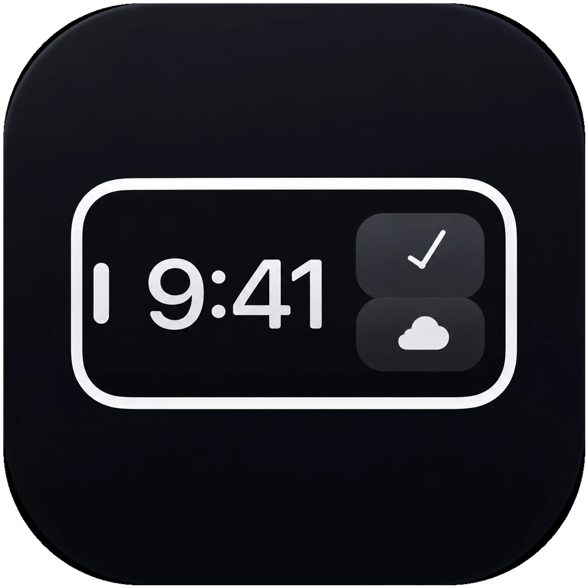
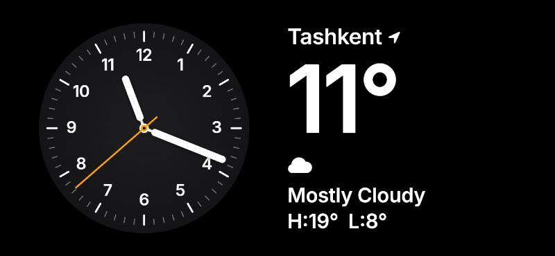
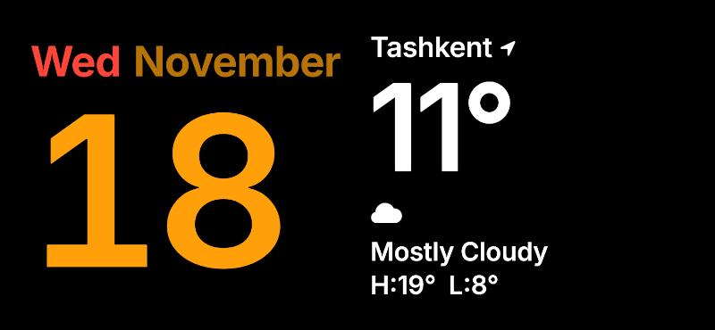
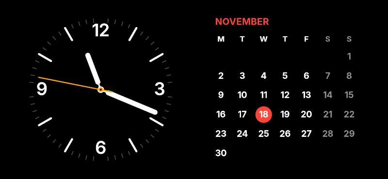
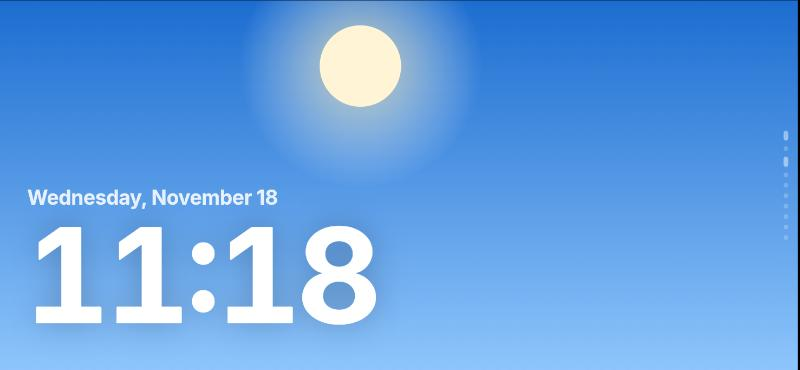
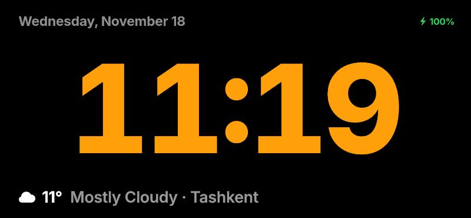
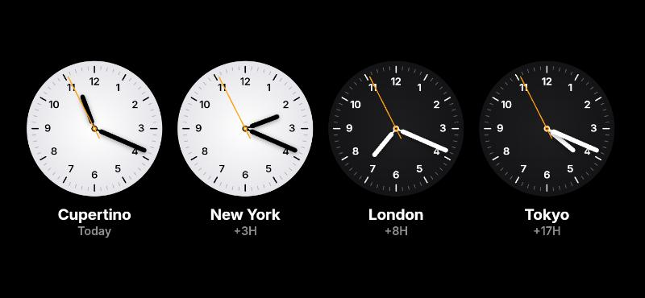
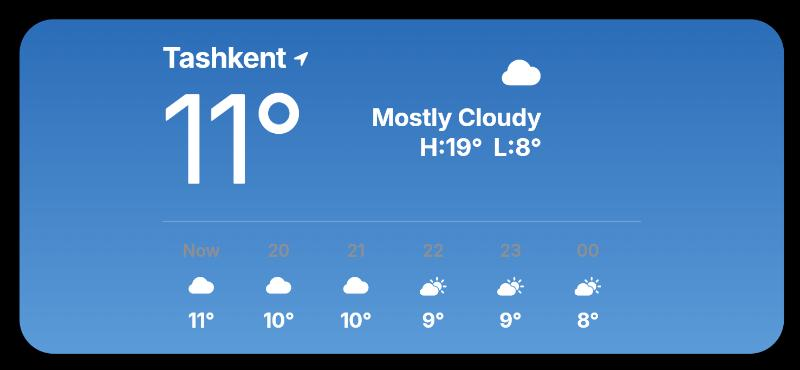
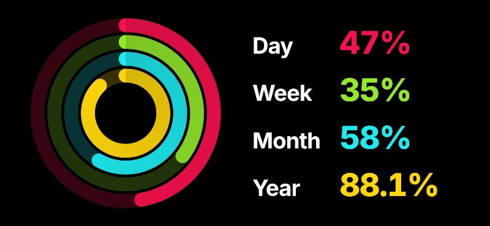

<p align="center">
  
</p>

<h1 align="center">So StandBy</h1>

<p align="center">
  An iOS‑style StandBy display for Android, built with Flutter.<br/>
  Dock your phone, turn it sideways (or not), and get a clock, weather, calendar and media screen.
</p>

<p align="center">
  <a href="https://github.com/qaxxorovxd-mobile/so-standby/releases/latest"><b>⬇ Download the latest APK</b></a>
</p>

<p align="center">
  
  
  
  
</p>

## Features

- **23 StandBy views.** Swipe left or right through 13 pages. On the Clock page, swipe up or down to pick one of 10 clock styles.
- **Portrait and landscape.** Every view has its own layout for each orientation.
- **iOS look.** Black background, Apple system colors, and Inter typography (the closest open font to SF Pro) in bold weights with tabular digits.
- **Live weather.** Uses [Open‑Meteo](https://open-meteo.com) (no API key), your current location or a city you pick, and shows hourly forecasts.
- **Media controls.** Shows what's playing in Spotify, YouTube Music or any app with a media session, with album art, progress, and play/pause/skip.
- **Night Mode.** A red, sleep‑friendly tint that you can set to Off, Auto (22:00–06:00) or On, or toggle from the moon button.
- **Burn‑in protection.** Content shifts a few pixels every minute.
- **Keep screen on.** Optional, controlled by a setting.
- **Personalization.** 11 accent colors, 12/24‑hour time, °C/°F, and a smooth sweeping second hand.

### Pages (swipe sideways)

| # | Page | # | Page |
|---|------|---|------|
| 1 | Smart: time, date, weather and hourly forecast | 8 | World Clock: Cupertino, New York, London, Tokyo |
| 2 | **Clock: 10 styles (swipe up/down)** | 9 | Analog + Batteries |
| 3 | Analog + Weather | 10 | Day Progress: day, week, month and year rings |
| 4 | Date + Weather | 11 | Date + Calendar |
| 5 | Analog + Calendar | 12 | Stopwatch with laps |
| 6 | Digital + Calendar | 13 | Now Playing (media controls) |
| 7 | Weather forecast card | | |

### Clock styles (swipe up/down)

Digital · Analog · Solar · Float · Flip · Glow · Word Clock · Dot Matrix · Duotone · Ring

<p align="center">
  
  
  
  
  
  
</p>

## Gestures

| Gesture | Action |
|---|---|
| Swipe left / right | Next / previous page |
| Swipe up / down (Clock page) | Change clock style |
| Tap | Show page dots, Night Mode and Settings buttons |
| Long‑press | Open Settings |

## Permissions

On first launch, So StandBy asks for:

- **Location**, to show weather for your city. You can type a city in Settings instead.
- **Notification access**, so the app can read and control the active media session for the Now Playing page.

Nothing is collected or uploaded. The only network calls are to Open‑Meteo, to fetch the forecast.

## Install

1. Download `SoStandBy-x.y.z.apk` from [Releases](https://github.com/qaxxorovxd-mobile/so-standby/releases).
2. Open it on your Android phone and allow installing from this source.
3. Launch **So StandBy**, grant permissions, then dock your phone.

Requires Android 7.0 (API 24) or newer.

## Build from source

```bash
flutter pub get
flutter build apk --release
# → build/app/outputs/flutter-apk/app-release.apk
```

Built with Flutter 3.50 / Dart 3.14.

### Project layout

```
lib/
  core/        settings, l10n strings, clock ticker, text styles
  services/    weather (Open‑Meteo), media (MethodChannel), battery
  widgets/     analog clock painter, weather/date/calendar tiles, media card
  screens/     onboarding, StandBy pager, pages, clock styles, settings sheet
android/app/src/main/kotlin/…
  MainActivity.kt          media session bridge (now playing + transport controls)
  MediaListenerService.kt  notification listener that unlocks media sessions
```

## Credits

- Weather data: [Open‑Meteo](https://open-meteo.com)
- Font: [Inter](https://rsms.me/inter/) (SIL Open Font License)
- Inspired by Apple's StandBy. This is an independent project and is not affiliated with Apple.
